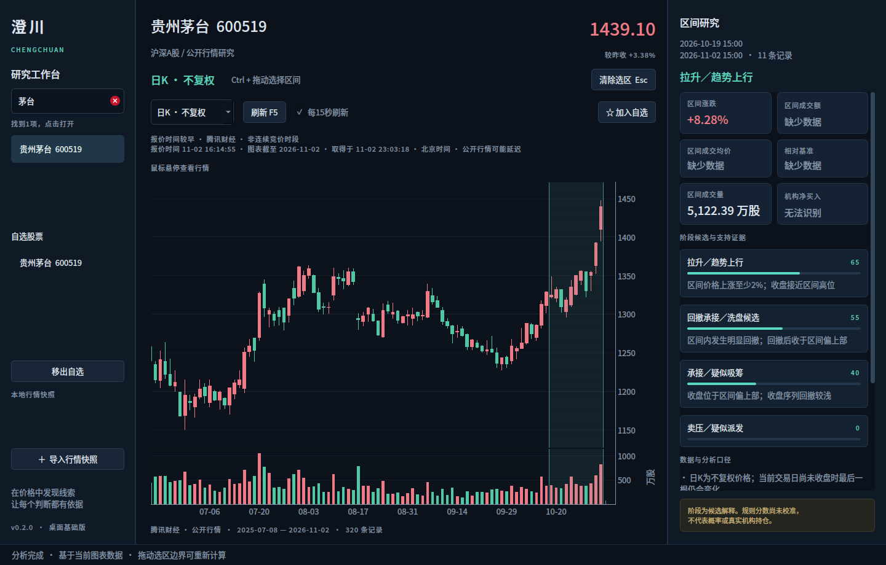

# 澄川 Chengchuan

本地股票研究工作台：看行情、选区间、计算特征、追溯证据。



当前为**0.2行情工作台**：可以按名称、代码或拼音搜索沪深A股，点击切换股票，查看最新公开报价、日K和分钟采样分时，维护自选，并每15秒自动刷新。支持Ctrl拖选区间分析和本地快照导入。周K、复权、完整分钟K线和Level-2按路线继续加入。

## 启动桌面

需要Python 3.10或更高版本。在仓库目录执行：

```bash
python -m venv .venv
.venv/bin/python -m pip install -c requirements/desktop-tested.txt -e '.[desktop,dev]'
.venv/bin/python -m chengchuan
```

Windows使用`.venv\Scripts\python`替换`.venv/bin/python`。安装包尚未构建；不同平台需要分别验收。

依赖已排除PySide6 6.12.0：该版本在Python 3.10/3.11下反复调用Qt方法会损坏`None`引用计数，
导致鼠标交互时出现`none_dealloc: deallocating None`并退出。已安装旧环境时，重新执行上面的
`pip install`命令即可切换到已验证的6.11.3，无须更换Python。

默认联网打开上次查看的股票，首次为久立特材002318。左侧输入六位代码回车可直接打开，输入名称或拼音后点击搜索结果；“加入自选”保存当前股票，自选支持拖动排序和移除。图表上方可切换日K／分时、F5刷新、开启或暂停每15秒刷新。

报价时间、图表覆盖时间和取得时间分别显示，统一为北京时间。当前使用腾讯公开行情轮询，可能延迟，不是交易所逐笔推送。收盘后价格保持源提供的最后有效报价；无有效报价、网络失败和历史缓存均有明确提示。刷新同股时保留缩放和选区，切股时清空上一只股票的数据与分析。

Ctrl左键拖动选择时间段，松开后计算，拖动边界调整，Esc清除，Ctrl＋O导入旧版标准JSON快照。本地快照模式不会自动联网更新。

```bash
.venv/bin/python -m chengchuan --symbol 600519 --interval day
# 仅在启动时打开本地示例，不发起行情请求
.venv/bin/python -m chengchuan --offline
# 打开指定历史快照
.venv/bin/python -m chengchuan \
  --dataset reports/jiuli_20261102_full_day.dataset.json
```

工作区、自选、行情缓存和轮转日志默认保存到操作系统的应用数据目录，可用`--state-dir PATH`指定。行情缓存按股票和周期隔离，联网失败时保留原数据时间，绝不标为新行情。当前单个导入快照上限32MB。

## 规划与架构

- [产品规划与当前功能](docs/PRODUCT.md)
- [分阶段路线与验收清单](docs/ROADMAP.md)
- [量价位置与未来1—2交易日联合预测规划](docs/SHORT_HORIZON_FORECAST.md)（仅规划，未实现或验证）
- [架构、性能与稳定性约束](docs/ARCHITECTURE.md)
- [UI设计和操作规范](docs/UI_DESIGN.md)
- [架构决策](docs/DECISIONS.md)
- [开发和Git约定](CONTRIBUTING.md)
- [变更记录](CHANGELOG.md)

新架构采用PySide6＋PyQtGraph，领域和应用层独立于GUI、供应商与数据库。旧分析引擎位于兼容边界，之后可以逐步替换。

## 桌面验证

```bash
.venv/bin/python -m unittest discover -s tests -v
.venv/bin/ruff check chengchuan tests/test_chengchuan.py tests/test_desktop.py tests/test_market*.py scripts
QT_QPA_PLATFORM=offscreen .venv/bin/python -m chengchuan \
  --offline --state-dir /tmp/chengchuan-preview --screenshot /tmp/chengchuan-preview.png
# Linux桌面交互复验：悬停、点击、Ctrl拖选、Esc和日K/分时切换
QT_QPA_PLATFORM=xcb .venv/bin/python -m scripts.check_desktop_stability
# 联网实机验收（额外等待一次15秒定时刷新）
QT_QPA_PLATFORM=xcb .venv/bin/python -m scripts.check_market_workbench --wait-refresh
```

离屏检查不能替代真实目标系统和显示器验收。详见[行情工作台验证](docs/VALIDATION_MARKET.md)和[原Qt崩溃排查记录](docs/VALIDATION.md)。

## 公开数据原型说明（兼容保留）

以下说明适用于保留的`flowradar`命令行工具；新GUI当前读取其`.dataset.json`快照。

支持选择数小时、数天或数周的区间，计算量价、相对强弱、订单金额分类和多种阶段解释，并生成本地可打开的交互式 HTML、Markdown、JSON 报告。

当前版本是 **公开数据研究原型**。它不连接证券交易账户，也没有经过真实机构账户标签校准。阶段规则分数不是概率；“吸筹、洗盘、派发”是候选解释。

## 查看久立示例

- [2026-11-02全天报告](reports/jiuli_20261102_full_day.html)
- [2026-11-02午后两小时报告](reports/jiuli_20261102_afternoon.html)
- [2026-10-19至11-02多日报告](reports/jiuli_20261019_1102.html)
- [本次验证记录](docs/验证记录_2026-11-02.md)

## 快速运行

需要 Python 3.10 或更高版本，无第三方运行依赖。在本目录执行：

```bash
# 小时区间：以北京时间输入起止时间
python -m flowradar analyze --symbol 002318 --interval minute \
  --start 2026-11-02T13:00 --end 2026-11-02T15:00 \
  --refresh --output reports/jiuli_20261102_afternoon

# 多日／多周区间
python -m flowradar analyze --symbol 002318 --interval day \
  --start 2026-10-19 --end 2026-11-02 \
  --refresh --output reports/jiuli_20261019_1102

# 已保存数据离线复算，无须重新请求接口
python -m flowradar analyze \
  --dataset reports/jiuli_20261102_afternoon.dataset.json \
  --start 2026-11-02T09:30 --end 2026-11-02T15:00 \
  --output reports/jiuli_20261102_full_day

# 滚动观察：检查规则候选与后续5个交易日价格表现的关系
python -m flowradar evaluate --symbol 002318 --interval day \
  --start 2026-09-01 --end 2026-11-02 \
  --lookback 20 --horizon 5 --output reports/jiuli_outcomes
```

打开输出的 `.html` 即可查看报告；图表滑块仅缩放价格图，不改变报告分析区间。重新分析请再次运行命令。

代码不自动选择或调用付费 AI 模型。软件的数字由可复算程序计算，当前也不需要 OpenAI API 密钥。

## 已实现

- 公开分钟行情、日线行情、基准行情、平台订单金额分类的采集与本地缓存。
- 小时／多日／多周区间分析，以及 CSV、标准 JSON 数据导入。
- 成交额和成交量单位统一；分钟累计数据先转换为增量，再切割分析区间。
- “承接／疑似吸筹、拉升／趋势上行、卖压／疑似派发、回撤承接／洗盘候选”规则证据。
- 同时展示其他解释、数据覆盖和缺失项。
- 原始响应缓存、来源链接、获取时间、离线复算与交互式报告。
- 只使用分析时点之前数据的滚动价格结果观察工具。

## 明确的能力边界

1. **机构净买入金额目前输出无法识别。** 平台大小单净额不等于真实机构持仓变化。没有经验证的估计方法时，软件不会编造金额区间。
2. **未运行母单识别或 HMM。** TWAP、VWAP、POV 和限价执行目前列为候选模型；分钟数据和金额分档不构成某个参与者的执行轨迹。
3. 免费分钟接口通常只覆盖近期几个交易日。多周小时级历史研究需要补充分钟或逐笔数据；日线可用于多周形态分析。
4. 公共成交明细可能存在3秒时间格点。这个周期不能直接用于识别3秒拆单算法。
5. 日线当前未复权；跨除权除息日需另行处理公司行为。
6. 主日线源失败时回退腾讯日线。回退源不含成交额，成交额和 VWAP 将明确缺失，不用收盘价乘成交量冒充。
7. 历史价格表现只能验证信号与后续走势的关系，不能证明“主力识别准确率”。窗口重叠，也不能把样本当成相互独立。

## CSV 输入

```csv
timestamp,open,high,low,close,volume_shares,amount_yuan
2026-11-02T13:00:00,16.28,16.28,16.28,16.28,0,0
2026-11-02T13:01:00,16.28,16.30,16.27,16.29,10000,162850
```

成交量单位是**股**，成交额单位是**元**。上述两条仅展示格式，不是历史成交记录。没有成交额时留空，不能填0冒充真实值。

```bash
python -m flowradar analyze --csv your_bars.csv --symbol 002318 \
  --interval minute --start 2026-11-02T13:00 --end 2026-11-02T14:00 \
  --output reports/imported
```

## 验证

```bash
python -m unittest discover -s tests -v
```

开发目标、数据升级、模型训练、历史案例和验收标准见 [开发任务书](docs/资金行为研究系统开发任务书.md)。
