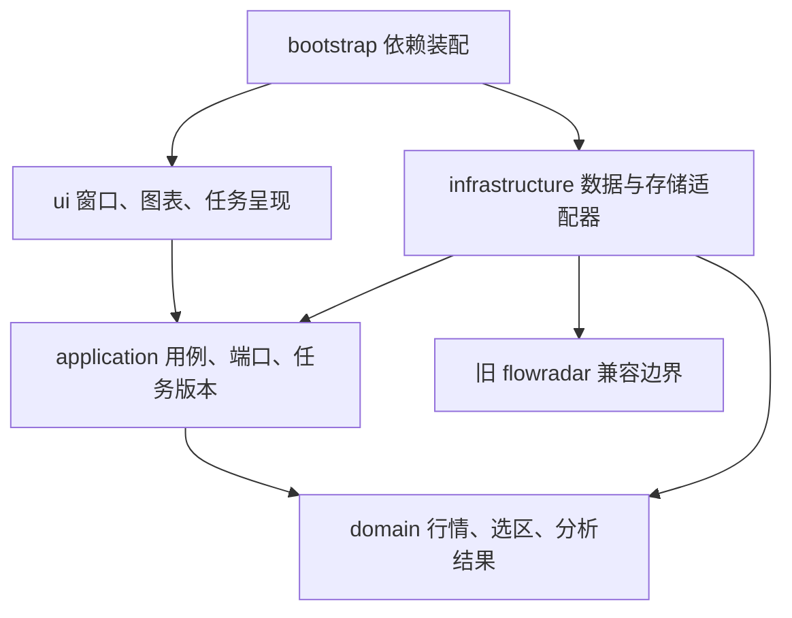

# 澄川：架构与工程约束

采用单进程为主的模块化桌面程序。明确模块边界，按负载引入工作进程，不提前拆成微服务。

## 代码分层

| 目录 | 职责 | 允许依赖 |
|---|---|---|
| `domain/` | 不可变行情、选区、结果契约与基本校验 | Python标准库 |
| `application/` | 分析用例、缓存策略、仓储与引擎端口、错误类型 | domain与标准库 |
| `infrastructure/` | 数据导入、旧引擎适配、SQLite等具体实现 | application、domain、供应商库 |
| `ui/` | 窗口、图表、键鼠事件、后台任务与结果呈现 | application、domain、Qt和绘图库 |
| `bootstrap.py` | 配置、日志、实现选择与依赖装配 | 上述各层 |

领域和应用层不导入Qt、SQLite、供应商协议或旧引擎。UI不直接导入基础设施。边界由测试检查。对象在装配入口显式注入；暂不引入全局服务定位器、反射插件加载器或通用事件总线。

## 旧代码评估与迁移

旧`flowradar`的单位校验、累计值转换、公开行情适配、分析结果与18项测试有保留价值。其大分析函数、自由字典、采集与缓存策略不适合作为长期桌面程序的全部核心。

当前通过`LegacyJsonRepository`和`LegacyAnalysisEngine`隔离旧类型。新UI只看到新领域模型及分析结果。后续原生特征引擎实现同一AnalysisEngine端口，在独立样本验证后替换；旧CLI仍可作为对照运行。没有在没有替代物时删除可用功能。

## 数据契约

- 时间使用包含时区的datetime；适配器负责将旧北京时间字符串转换，界面以北京时间显示。
- 价格元、成交量股、成交额元；缺失使用None，零代表确实为零。
- OHLC行情与分钟末采样价属于不同序列类型。后者的开、高、低字段为空，图表只能画采样线。
- 行情严格按时间递增，重复与逆序需要报告，不能静默覆盖。
- 选区使用交易记录索引`[start, stop)`，不按自然时间空档或像素近似推导日期。旧引擎的首末时间包含关系仅在兼容适配器内处理。
- 本地导入快照revision为原始文件内容SHA-256；0.2在线快照revision为行情序列内容摘要。取得时间独立于内容版本。分析缓存包含引擎版本、revision和选区；后续增加可配置参数时，参数摘要必须进入缓存键。
- 数据快照、算法版本、参数和所选区间共同决定复算结果。图表显示范围不改变分析窗口。
- 当前旧格式导入保守地把所有分钟快照视为采样价。真实分钟OHLC未来使用独立格式和能力声明，不根据字段恰好相等来猜测。

## 线程、请求与背压

当前Qt主线程只处理绘图、事件和展示；文件加载和分析经LatestTaskRunner运行。最多一个活动任务与一个待执行任务，后者被更新请求替换。RequestGate通过递增请求版本拦截旧结果。

这一策略适用于交互式加载与分析：用户最终只需要最新选区结果。**逐笔采集不能采用这种丢弃中间事件的策略。** 后续逐笔数据走独立的有界采集／落盘通道，检查序列连续性；UI接收聚合状态和节流刷新。

当前分析不能中断已经开始的内核计算，但可以丢弃其结果。重CPU模型和长回放增加进程执行器、协作取消及明确退出预算，不宣称Python线程能提高CPU计算的并行吞吐。

0.2网络搜索和行情各使用一个可终止的`spawn`子进程，通过私有管道返回领域数据。新请求立即终止旧请求；
UI用QTimer轮询完成，不执行HTTP。单个HTTP读取超时6秒、响应最多4MB，整项任务18秒超时；
自动轮询每15秒最多发起一项请求，运行中不重复排队。没有HTTP内部重试，下一轮或F5可重试。
关闭时停止定时器、终止并回收两个网络进程；已测试在挂起请求下窗口关闭小于1秒。
分析仍用原线程池，关闭最多先等待3秒，其后析构可能等待；不将长计算的退出也宣传为有界取消。

## 存储与数据源

工作区SQLite使用事务、WAL、独立连接和schema版本；连接在每次操作后关闭。损坏数据库明确报错，不自动删除。当前schema为1，超过该版本时拒绝覆盖。

当前公开研究数据仍保留旧文件快照。基础版单个快照上限32MB，防止误将大规模逐笔文件直接加载到图表。
0.2新增独立`market.sqlite`，保存按证券／周期隔离的最新行情帧和已搜索证券目录；最多200组行情、5000项目录。
SQLite事务允许请求被终止时保留上一份完整缓存。行情、报价和取得时间分别记录，缓存TTL为15秒，
强制刷新绕过TTL；失败可回退缓存但不改原取得时间。0.3另行保存预测用标准快照，不是完整原始HTTP／逐笔历史库。
逐笔历史后续优先评估Parquet与DuckDB，查询必须带股票与时间范围。

行情数据源约束：

1. 明确支持市场、周期、字段、历史覆盖和使用权限。
2. 可配置超时、有限重试、退避和调用频率；只对适合重试的读取失败执行重试。
3. 源数据缓存、取得时间、数据时间与来源记录分别保存。
4. 主源失败时明确回退；来源字段能力不足时保留缺失，不推算伪造。
5. 缓存是否过期由数据周期、交易时段与刷新策略决定，不能永远把旧响应当作当前行情。

## 扩展方式

0.4新增`domain/periods.py`统一12个图表周期；应用层`resampling.py`只处理真实OHLC与自然／交易时段桶，不依赖供应商或Qt。`MeozMarketProvider`只承担已核对协议与标准数据转换，`MeozClient/MeozStore`隔离HTTP、私有密钥、响应缓存、增量日线与本机调用预留。UI沿用MarketService，不直接访问付费API。

MeoZ本机原始缓存默认`~/.meoz/chengchuan.sqlite`，跨工作区／进程共用；GUI帧按源分库存储，序列化兼容v1并在v2保存均价线／基准价／来源名。HTTP前事务预留、全接口保守95次／日与0.4秒间隔；源缓存盘中180秒复用，历史分钟持久保存，日历每日复用，日线只更新末段。失败／中断计入预留、不无限重试；原时间戳与缓存状态不改成当前行情。详细边界见[MEOZ_DATA](MEOZ_DATA.md)。

0.5将日期定位与涨跌幅口径放在独立的`application/chart_tools.py`，原生日历和十字线浮窗分别由`ui/date_navigator.py`、`ui/chart_cursor.py`管理。历史能力由Provider声明，`MarketService.load(as_of=日期)`与最新行情共用缓存／异步流程，网络请求键与迟到结果检查包含日期。`MarketFrame`携带`as_of`及逐日昨收参考，拒绝截止日之后的行情；序列化v3兼容v1／v2，历史缓存键为`周期@日期`，不覆盖最新帧。过去日期且取得时间不早于当日15:15的完整帧可长期复用，盘中帧仍会更新。

历史分钟沿用单日原始响应缓存，日历可先查已有近期响应，不足时按范围请求；日线从完整档案过滤并重新聚合周月季年。历史浏览暂停自动刷新；日期切换重置选区和浮窗，源请求取消与超时继续由既有执行器管理。历史截断属于当前可得数据重建，未解决供应商历史修订及严格当时可得性，不等同于完整预测回放器。

0.5.1增加应用层`MarketSources`端口，由`infrastructure/market_sources.py`装配猫爪／腾讯与各自缓存，bootstrap注入UI；窗口不直接读取密钥、HTTP或SQLite。源身份与能力说明由用例提供，源选择作为普通工作区设置保存；GUI和CLI共用基础设施中的私有配置写入函数。切换时取消网络与搜索任务，再替换用例，取消后的迟到结果仍受原任务代次隔离。离线腾讯只允许缓存读取。

图表使用Qt完整视口更新，避免十字线与半透明子控件在边缘的局部重绘残像。移动只更新同一组四条线和两个浮窗，不累加图元；Qt合并绘制请求，沿用悬停频率上限和K线绘图缓存，分析、数据请求及指标计算不随鼠标运行。

0.6由`application/settings.py`的不可变`AppSettings`与`SettingsService`校验、加载及保存偏好，`ui/settings_dialog.py`只呈现分类表单并调用注入用例；MainWindow仅应用计时器、光标和源变更。普通偏好作为工作区`preferences`记录保存，格式version=1，兼容旧main记录的源／更新开关；更高版本或异常结构拒绝覆盖。工具栏外部源和刷新操作同步偏好，CLI显式来源在设置中一致呈现。

密钥仍通过已有私有配置适配器保存，永不进入`AppSettings`、工作区或行情任务参数。提交前先校验，密钥文件写入和SQLite偏好保存不是跨存储原子事务，部分成功通过`SettingsSaveError.key_saved`明确报告并清空UI输入；再次保存可只重试普通设置。源状态、路径、只读用量经`SettingsInfo`返回，不向UI返回现有密钥。单个设置窗口保留草稿，关闭清理输入；一般显示设置不发网络请求或重训模型。

日线／分钟先统一股与元，分时仅使用分钟收盘价；周/月/季/年和较大分钟K由真实OHLC组合，缺失不填造。新周期在旧分析适配器内使用独立基础统计分支，不把周线当日线套用阶段规则。长日线图表交给旧预测研究页时，计算输入限制在已核对日历内；原始完整快照仍可追溯，预测目标与P2排期不变。

新增数据源实现数据端口，新增分析引擎实现AnalysisEngine；业务用例不依赖其具体类。新特征优先做独立可测函数，并声明输入字段、数据粒度、参数及版本。

第一阶段不开放任意第三方插件自动执行。后续先提供开发者注册指标的静态接口，再规划公式表达式语言、依赖计算和界面参数表单。模型与指标输出数值、证据和图表标记；UI负责呈现，不能依赖模型内部实现。

## 0.3短周期预测研究边界

2026-11-04需求调整：本节记录既有0.3实现；后续开发以[下一交易日双时点需求](NEXT_DAY_FORECAST.md)为准，P2后置。模式仅盘后／14:35，均预测下一交易日。14:35需新增完整时间戳级历史视图、接收时间与标签成熟检查；当前日级`history_at`及H1／H2结果不能代表已支持14:35。模式和截止时间须进入模型、缓存、预测标识及档案，避免同日两个模式互相覆盖。

实现位于`domain/forecast.py`、`domain/analogue.py`、`application/forecast*.py`，不依赖Qt或第三方ML库。`StageProvider`隔离旧规则，`ForecastJournal`隔离持久化，`forecast.py`与bootstrap分别装配CLI和GUI。以下约束已用于首个研究切片，完整验证仍待完成。

- 特征提取和未来预测作为与区间AnalysisService并列的用例，复用标准行情和数据质量信息；
  阶段评分仍是候选解释，不能改名为上涨概率。
- 预测输入固定数据截止时点、日K完成状态、回看窗口、目标跨度和参数版本；任意Ctrl选区长度
  不隐式改变预测模型，盘中数据不冒充已完成日线。
- 缓存除证券和数据revision外，还需包括特征截止点、目标、特征参数、阶段／模型／校准版本；
  旧请求不得覆盖新股票或新截止点。
- 单次轻量计算复用有界后台调度；批量训练、回测和长期任务使用独立可取消进程，
  不进入UI线程、不随15秒行情刷新重新训练，保留现有网络进程隔离。
- 研究输入、实验和已发出的预测保存在独立的版本化档案中；当前market.sqlite的最新帧覆盖缓存
  继续承担行情工作台职责，不能当成完整研究数据库。
- 当前结果状态区分研究方向、并列不预测、输入不足、训练不足和日历不可用，任务失败另有提示；
  正式可用概率及过期状态管理后续完善。独立验证和校准前概率为空，不用50%或旧股票概率填补。

首个模型为滚动标准化k近邻：仅使用过去成熟训练样本拟合中位数填补和尺度，默认k21／最少40／最近160样本，不按本次回放结果调参。A用价格，B加量价，C加固定5／20日阶段分数。并列类别不预测；近邻原始频率仅用于内部损失诊断，用户概率为None。

`history_at`同时截断行情、订单分类与基准，重算过去内容摘要；预测内部拒绝D之后的行。H1／H2按2025／2026官方日历定位，目标缺失不顺延。枚举缺失基准交易日，保留历史不足、零量和日历不可用原因。当日收盘需本地时间及观察时间≥15:15、报价≥15:00且同日，不凭K线标识认定完成；过去日期属于历史重建口径。

`forecast.sqlite`保存快照、实验、预测、评价四类记录：不可覆盖快照内容，同一实验的相同预测重复写入无效，冲突则拒绝。先提交全部预测再提交评价；执行时间与逻辑D分开。单次最多2000条日线、档案512MB上限，超限需新目录，不自动清历史。原始价格标签尚未系统核验除权除息，明确标为诊断。

GUI预测／回测／导出共用独立可终止spawn执行器，任务120秒上限；重复请求替换旧任务，切股或改参数即清结果，关闭终止工作进程。轻微报价刷新不重算训练。导出先构建临时文件再替换各完整文件；三种文件之间不承诺跨文件原子事务。图表历史回放遮罩、长期任务续跑与独立前瞻评价调度尚未实现。

[历史验证方案](FORECAST_VALIDATION.md)进一步要求预测侧只能取得截至D的历史视图，
未来标签由独立评价侧持有。模拟截止时点与真实执行时间分别记录，先锁定预测再追加评价。
内部实验概率带未校准标记保存，不与上述用户概率字段混用；完整账本保存失败、缺失和不预测，批量续跑不重复计数。

## 性能与稳定性验收目标

以下为待测目标，不是已通过的性能承诺。参考目标是普通四核、16GB内存桌面机；实际验收需记录CPU、系统、分辨率、数据量和版本。

| 场景 | 初始目标 | 当前状态 |
|---|---|---|
| 1万根K线交互 | 平移／缩放大部分帧不超过33毫秒 | 尚未做此规模帧时测试 |
| 缓存上的普通区间分析 | p95不超过300毫秒，不含联网 | 小样本已跑通，尚未完成p95负载基准 |
| 交互任务队列 | 1个运行＋1个待执行，无无限堆积 | 已实现并测试 |
| 分析缓存 | 默认32项，按数据与算法版本隔离 | 已实现并测试 |
| 日志 | 单文件2MB，3份轮转备份 | 已配置 |
| 网络失败 | 界面可交互，源状态清楚，可重试 | 已有进程隔离、超时、缓存回退和快速切股验证 |
| 长时间运行 | 重复操作无持续增长、退出可靠 | 待压力与实机验收 |

当前蜡烛图缓存QPicture绘图指令，避免每根K线创建独立Qt对象；仍会加载当前快照全部记录，不宣称已经完成超大行情的分页和可见区渲染。大规模数据到位后采用分块缓存、按需查询和可见区域渲染。

## 质量与交付

- 业务核心无需GUI依赖也可测试。桌面交互使用Qt离屏测试，原生Windows/Linux手工验收另列。
- 核心检查包括时间、单位、缺失值、复权、未来信息、旧结果覆盖、缓存失效和持久化事务。
- 依赖边界通过AST检查；新模块格式和静态问题由Ruff检查。
- 每个可交付切片有Git提交、变更记录、验证记录和明确能力限制。
- 发布包按目标操作系统构建，不能把Linux验收结果当成Windows安装包已验证。
