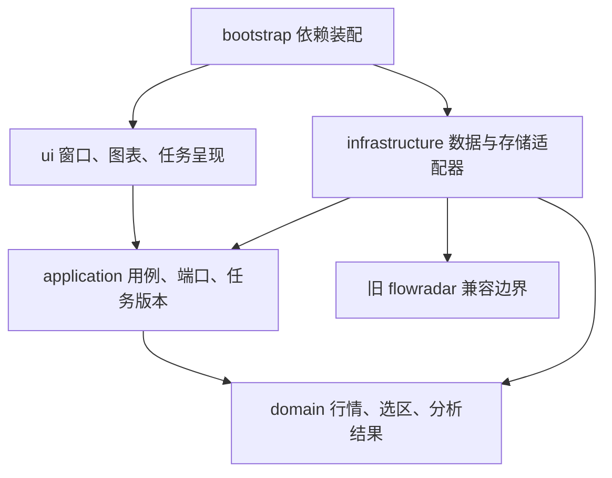

# 澄川：架构与工程约束

采用单进程为主的模块化桌面程序。明确模块边界，按负载引入工作进程，不提前拆成微服务。

## 代码分层

| 目录 | 职责 | 允许依赖 |
|---|---|---|
| `domain/` | 不可变行情、选区、结果契约与基本校验 | Python标准库 |
| `application/` | 分析用例、缓存策略、仓储与引擎端口、错误类型 | domain与标准库 |
| `infrastructure/` | 数据导入、旧引擎适配、SQLite等具体实现 | application、domain、供应商库 |
| `ui/` | 窗口、图表、键鼠事件、后台任务与结果呈现 | application、domain、Qt和绘图库 |
| `bootstrap.py` | 配置、日志、实现选择与依赖装配 | 上述各层 |

领域和应用层不导入Qt、SQLite、供应商协议或旧引擎。UI不直接导入基础设施。边界由测试检查。对象在装配入口显式注入；暂不引入全局服务定位器、反射插件加载器或通用事件总线。

## 旧代码评估与迁移

旧`flowradar`的单位校验、累计值转换、公开行情适配、分析结果与18项测试有保留价值。其大分析函数、自由字典、采集与缓存策略不适合作为长期桌面程序的全部核心。

当前通过`LegacyJsonRepository`和`LegacyAnalysisEngine`隔离旧类型。新UI只看到新领域模型及分析结果。后续原生特征引擎实现同一AnalysisEngine端口，在独立样本验证后替换；旧CLI仍可作为对照运行。没有在没有替代物时删除可用功能。

## 数据契约

- 时间使用包含时区的datetime；适配器负责将旧北京时间字符串转换，界面以北京时间显示。
- 价格元、成交量股、成交额元；缺失使用None，零代表确实为零。
- OHLC行情与分钟末采样价属于不同序列类型。后者的开、高、低字段为空，图表只能画采样线。
- 行情严格按时间递增，重复与逆序需要报告，不能静默覆盖。
- 选区使用交易记录索引`[start, stop)`，不按自然时间空档或像素近似推导日期。旧引擎的首末时间包含关系仅在兼容适配器内处理。
- 本地导入快照revision为原始文件内容SHA-256；0.2在线快照revision为行情序列内容摘要。取得时间独立于内容版本。分析缓存包含引擎版本、revision和选区；后续增加可配置参数时，参数摘要必须进入缓存键。
- 数据快照、算法版本、参数和所选区间共同决定复算结果。图表显示范围不改变分析窗口。
- 当前旧格式导入保守地把所有分钟快照视为采样价。真实分钟OHLC未来使用独立格式和能力声明，不根据字段恰好相等来猜测。

## 线程、请求与背压

当前Qt主线程只处理绘图、事件和展示；文件加载和分析经LatestTaskRunner运行。最多一个活动任务与一个待执行任务，后者被更新请求替换。RequestGate通过递增请求版本拦截旧结果。

这一策略适用于交互式加载与分析：用户最终只需要最新选区结果。**逐笔采集不能采用这种丢弃中间事件的策略。** 后续逐笔数据走独立的有界采集／落盘通道，检查序列连续性；UI接收聚合状态和节流刷新。

当前分析不能中断已经开始的内核计算，但可以丢弃其结果。重CPU模型和长回放增加进程执行器、协作取消及明确退出预算，不宣称Python线程能提高CPU计算的并行吞吐。

0.2网络搜索和行情各使用一个可终止的`spawn`子进程，通过私有管道返回领域数据。新请求立即终止旧请求；
UI用QTimer轮询完成，不执行HTTP。单个HTTP读取超时6秒、响应最多4MB，整项任务18秒超时；
自动轮询每15秒最多发起一项请求，运行中不重复排队。没有HTTP内部重试，下一轮或F5可重试。
关闭时停止定时器、终止并回收两个网络进程；已测试在挂起请求下窗口关闭小于1秒。
分析仍用原线程池，关闭最多先等待3秒，其后析构可能等待；不将长计算的退出也宣传为有界取消。

## 存储与数据源

当前SQLite只保存工作区，使用事务、WAL、独立连接和schema版本；连接在每次操作后关闭。损坏数据库明确报错，不自动删除。当前schema为1，超过该版本时拒绝覆盖。

当前公开研究数据仍保留旧文件快照。基础版单个快照上限32MB，防止误将大规模逐笔文件直接加载到图表。
0.2新增独立`market.sqlite`，保存按证券／周期隔离的最新行情帧和已搜索证券目录；最多200组行情、5000项目录。
SQLite事务允许请求被终止时保留上一份完整缓存。行情、报价和取得时间分别记录，缓存TTL为15秒，
强制刷新绕过TTL；失败可回退缓存但不改原取得时间。完整不可变历史版本与原始响应归档尚未实现。
逐笔历史后续优先评估Parquet与DuckDB，查询必须带股票与时间范围。

行情数据源约束：

1. 明确支持市场、周期、字段、历史覆盖和使用权限。
2. 可配置超时、有限重试、退避和调用频率；只对适合重试的读取失败执行重试。
3. 源数据缓存、取得时间、数据时间与来源记录分别保存。
4. 主源失败时明确回退；来源字段能力不足时保留缺失，不推算伪造。
5. 缓存是否过期由数据周期、交易时段与刷新策略决定，不能永远把旧响应当作当前行情。

## 扩展方式

新增数据源实现数据端口，新增分析引擎实现AnalysisEngine；业务用例不依赖其具体类。新特征优先做独立可测函数，并声明输入字段、数据粒度、参数及版本。

第一阶段不开放任意第三方插件自动执行。后续先提供开发者注册指标的静态接口，再规划公式表达式语言、依赖计算和界面参数表单。模型与指标输出数值、证据和图表标记；UI负责呈现，不能依赖模型内部实现。

## 规划中的短周期预测边界

2026-11-03新增[量价位置与阶段联合预测专项](SHORT_HORIZON_FORECAST.md)，以下均为设计约束，
尚未新增实现或修改现有端口。

- 特征提取和未来预测作为与区间AnalysisService并列的用例，复用标准行情和数据质量信息；
  阶段评分仍是候选解释，不能改名为上涨概率。
- 预测输入固定数据截止时点、日K完成状态、回看窗口、目标跨度和参数版本；任意Ctrl选区长度
  不隐式改变预测模型，盘中数据不冒充已完成日线。
- 缓存除证券和数据revision外，还需包括特征截止点、目标、特征参数、阶段／模型／校准版本；
  旧请求不得覆盖新股票或新截止点。
- 单次轻量计算复用有界后台调度；批量训练、回测和长期任务使用独立可取消进程，
  不进入UI线程、不随15秒行情刷新重新训练，保留现有网络进程隔离。
- 研究输入、实验和已发出的预测保存在独立的版本化档案中；当前market.sqlite的最新帧覆盖缓存
  继续承担行情工作台职责，不能当成完整研究数据库。
- 独立的预测结果状态包含仅特征、待验证、数据不足、可用预测、过期、不适用与失败；
  通过独立时间验证和校准前，概率为空，不能使用50%或旧股票概率填补。

## 性能与稳定性验收目标

以下为待测目标，不是已通过的性能承诺。参考目标是普通四核、16GB内存桌面机；实际验收需记录CPU、系统、分辨率、数据量和版本。

| 场景 | 初始目标 | 当前状态 |
|---|---|---|
| 1万根K线交互 | 平移／缩放大部分帧不超过33毫秒 | 尚未做此规模帧时测试 |
| 缓存上的普通区间分析 | p95不超过300毫秒，不含联网 | 小样本已跑通，尚未完成p95负载基准 |
| 交互任务队列 | 1个运行＋1个待执行，无无限堆积 | 已实现并测试 |
| 分析缓存 | 默认32项，按数据与算法版本隔离 | 已实现并测试 |
| 日志 | 单文件2MB，3份轮转备份 | 已配置 |
| 网络失败 | 界面可交互，源状态清楚，可重试 | 已有进程隔离、超时、缓存回退和快速切股验证 |
| 长时间运行 | 重复操作无持续增长、退出可靠 | 待压力与实机验收 |

当前蜡烛图缓存QPicture绘图指令，避免每根K线创建独立Qt对象；仍会加载当前快照全部记录，不宣称已经完成超大行情的分页和可见区渲染。大规模数据到位后采用分块缓存、按需查询和可见区域渲染。

## 质量与交付

- 业务核心无需GUI依赖也可测试。桌面交互使用Qt离屏测试，原生Windows/Linux手工验收另列。
- 核心检查包括时间、单位、缺失值、复权、未来信息、旧结果覆盖、缓存失效和持久化事务。
- 依赖边界通过AST检查；新模块格式和静态问题由Ruff检查。
- 每个可交付切片有Git提交、变更记录、验证记录和明确能力限制。
- 发布包按目标操作系统构建，不能把Linux验收结果当成Windows安装包已验证。
