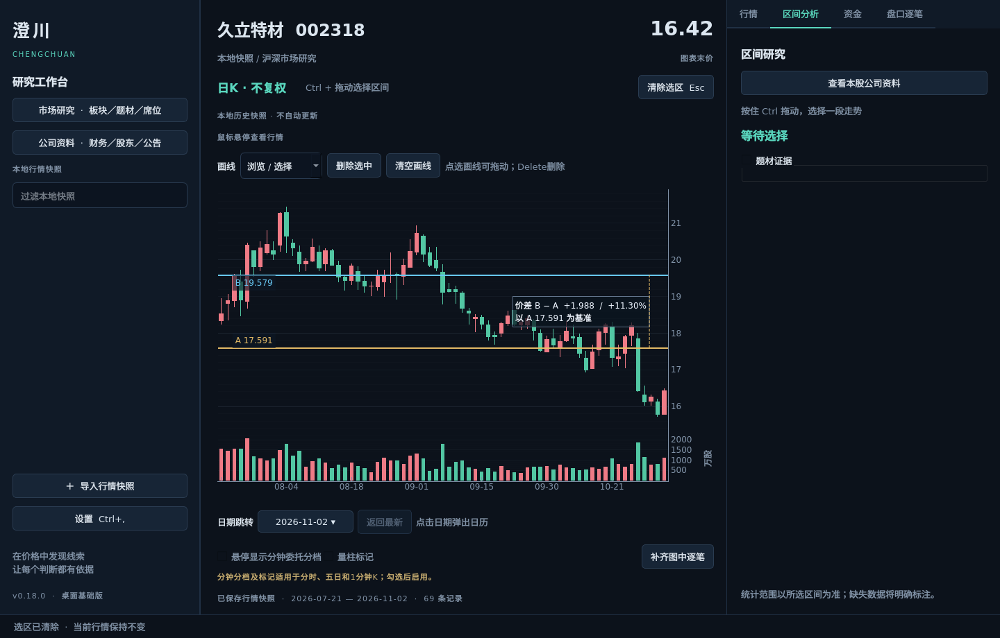

# 画线与日K分时跳转（0.18）

2026-11-07。图表上方新增“画线”工具栏；默认浏览，不自动创建画线。

| 工具 | 放置方式 | 编辑方式 |
|---|---|---|
| 水平线 | 点击一个价格 | 拖动调整价格 |
| 垂直线 | 点击一个时间位置 | 拖动调整至其他行情记录 |
| 趋势线 | 依次点击两个端点 | 拖动线段，或选中后拖端点 |
| 矩形 | 依次点击两个对角 | 拖动矩形，或选中后拖角点 |
| 双线测距 | 先点基准价格A，再点目标价格B | 两条水平线分别拖动，实时更新价差和百分比 |

双线测距用金色表示A、蓝色表示B。价差为`B−A`，百分比为`(B−A)/A×100%`。例如A=10、B=12，结果为+2、+20%；B拖到8则为−2、−20%。A始终是第一条线，不因上下位置交换而改变。浮层背景半透明，显示A基准价，缩放和平移时跟随图表位置。

放置完一个对象自动回到浏览模式。点击画线可选中；“删除选中”或图表获得焦点后的Delete删除该对象；双线测距按一组删除。“清空画线”仅清空当前证券、当前周期。Esc或绘制时右键取消未完成的画线。Ctrl拖选区间优先于画线模式。

画线按证券及周期隔离，指数也可画线。价格按当前图表原始价格保存；不同周期不会共用同一组画线。时间锚点绑定行情时间，拖动时吸附到最近一条记录，不存容易随补数偏移的序号。刷新不重建已有图形；补入更早记录后重新映射时间位置。趋势线、垂直线、矩形的锚点不在当前加载范围内时暂时隐藏；水平价格线及双线测距不受加载日期影响。

新增或编辑完成后，延迟400毫秒写入独立的`chart_drawings`工作区记录，关闭窗口时补存；鼠标移动和行情刷新不反复写库。每个证券周期最多100个对象，全部档案最多2000个。保存失败在状态栏提示，并保留内存中的修改。无法识别的更高版本档案不覆盖。

在浏览模式下，双击日K蜡烛的实体或影线，打开该证券、该日期的分时图。直接复用现有历史行情、缓存与任务取消流程，图表周期与日期选择器同步更新。该动作只适用于日K主图；成交量区、其他周期和正在绘制的对象不会触发。双击已有画线优先选中画线。当前数据源不支持历史分时，或未连接数据源时保留原图并提示切换到已配置的猫爪源。该日期没有已发布分时数据时沿用来源错误提示，不代替成其他日期。

`domain/drawings.py`定义时间锚点、画线及价差口径；`application/drawings.py`负责有界档案和工作区端口；`ui/chart_drawings.py`负责绘制交互、可编辑图元及标签。图表仅转交画线事件、发出日K日期信号，主窗口负责切换行情。

实现使用现有PyQtGraph，没有新增依赖或后台采集。测试均强制offscreen，在后台运行，覆盖真实鼠标放置、拖线交叉、ROI端点编辑、Ctrl选区、Esc取消、Delete删除、股票隔离、时间补数和对应日期跳转。

验证：380项完整回归通过；新增9项测试覆盖计算、档案与真实Qt手势。最小窗口新增工具栏后，价格区和量区的最小高度按可用空间调整，底部光标完整重绘回归通过。真实久立离线快照在1440×920和1100×740后台运行并保存、截图，未调用网络。截图见下方。

