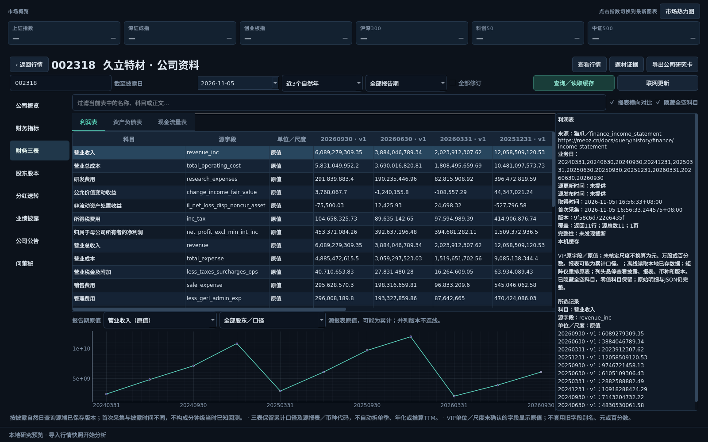

# 公司资料工作区 · 0.14

2026-11-05。从左侧“公司资料”或行情右侧“查看本股公司资料”进入，提供公司概览、财务指标、财务三表、股东股本、分红送转、业绩披露、公司公告、问董秘八类资料。



## 操作

1. 输入沪深股票代码，选择**截至披露日**、近1／3／5个自然年、可选报告期；“全部修订”保留已披露的全部版本。来自行情的入口带入股票，进入时只读取概览。
2. 点击左侧分类按需查询。“查询／读取缓存”和F5优先读缓存；“联网更新”主动尝试更新本分类，离线启动仍保持离线。不会自动把八类资料全部轮询。
3. 表头可排序，过滤框仅筛选本地数据；悬停表头查看源字段、字段含义、单位及版本。资料页默认保留源行／科目顺序。
4. 三表勾选“报表横向对比”，按科目查看各期。默认隐藏全空科目，**零值继续显示**；取消勾选可看原始行。表格与曲线之间可拖动调整高度。
5. 曲线切换指标及股东／口径，最多同时画8组；不同报表代码、币种、修订及股东分开。并列版本、同一分组中不能唯一对应的点不强行连线。
6. 股东页分别查看十大股东及十大流通股东的相邻期对比、户数、股本事件。指定报告期时以该期与前一可用期比较；缺少完整可比期时不补零。
7. 公告原文仅在选中并点击“打开所选公告原文”或双击有链接的记录后打开；程序不自动下载附件、打开网页或执行内容中的HTML。问答保留问题、回答及各自时间。
8. 可返回行情或进入题材证据。导出Markdown／JSON公司研究卡，包含查询条件、来源、日期、版本、完整性及字段说明。Markdown三表按矩阵排布，JSON保留全部原始行与字段。

公司资料的日期是**披露截止日**，与行情图表的日期独立；可选择自然日。基础信息始终是当前档案，估值采用所选日之前最近可用交易日，卡片带实际日期，不把周末当成交易日。

## 数据口径

| 内容 | 说明 |
|---|---|
| VIP原字段 | 财务指标、三表、股东股本遵循1.0.52原字段契约，保留大小写、`m_`字段、零、null和源新增字段。VIP在这里是源字段契约称谓，权限以接口实际响应为准 |
| 单位 | 多数字段的尺度在官方契约中尚未确认，显示**原值**，不自行换算为元、万元、股或百分数。估值股本为万股、市值为元；分红现金为每股元等明确单位按契约展示 |
| 同名字段 | `finance_indicator.net_profit`是**净利率**，不是净利润金额；利润表归母净利润另有原字段。按端点分别解释，不套用旧Tushare别名 |
| 报表 | 保留报告期、披露日、版本、歧义标志、报表及币种代码。不确认的代码不擅自叫合并／母公司或人民币；不自动拆单季、年化、计算TTM或财务造假评分 |
| 股东 | 数量差／比例差仅为同类表、精确名称、可唯一对应记录的源值差。缺席前十不等于持股归零、清仓或从零买入；股本送转也会影响数量，不把差额称净买入或实时北向 |
| 修订 | 财务接口传`as_of`和`version`，按源端已保存披露记录选择。并列版本保留，图线不选择一个当作唯一真值 |
| 预告与预约 | 已公告的未来报告期预告可显示；预告区间、快报、正式报表及预约／实际披露日期分开，不将预案当作已经实现的业绩 |
| 覆盖 | 财务契约首期标注2026起回填，实际样本含更早记录；公告保留2025—2026部分，问答自2026-06-26积累。查询年限不等于完整覆盖，无记录不证明公司没有相应事项 |

**日级回看不等于严格分钟级回测。** 公告披露时间可能只有日期，源端可能以后回填；取到时间、首次采集与源披露时间分别保留。缺披露日或并列版本会提示，不能将它们默认用作14:35当时已知样本。预测增强继续为P2。

公司全称、英文名、交易所等基本字段可能源未提供，页面保留缺失状态；不会自行填造主营构成、客户名单、联系方式、历史实控人或实时股东交易。

## 缓存、稳定性与复验

基础资料默认缓存24小时、财务类2小时、公告／问答30分钟、估值3分钟；主动更新仍受已有额度／错误退避保护。每次仅查询一股、本分类所需接口；每接口最多6页／3000行、最多512字段。矩阵最多排最新80条记录，原始表与JSON保留全部已取数据。

原始缓存共用现有私有数据库，另在状态目录`company.sqlite`追加公司资料档案，设置页可看到路径；档案上限256MB。离线可回放已归档的空结果，并注明采集时间和非最新覆盖，不为“补空”自动联网。Key仅留在本机配置，不进入研究卡和Git。

切条件、切分类、换数据源、离开页面或关闭时取消任务，迟到结果不覆盖新股票。当前价格图不因公司查询而重建。表格和曲线复用对象；原文用纯文本，外链只允许有效HTTP(S)并由用户点击。

```bash
QT_QPA_PLATFORM=offscreen .venv/bin/python -m unittest discover -s tests -p 'test_company*.py'
.venv/bin/python -X faulthandler -m scripts.check_company_desktop --as-of 20261105
```

第二个脚本强制offscreen、仅使用本地缓存／档案，并禁用外链打开；生成八类页面和1100×740布局截图。需先有对应日期缓存。实测、截图及安装包范围见[验证记录](VALIDATION_COMPANY_INFORMATION.md)，设计来源见[规划](COMPANY_INFORMATION_PLAN.md)。
