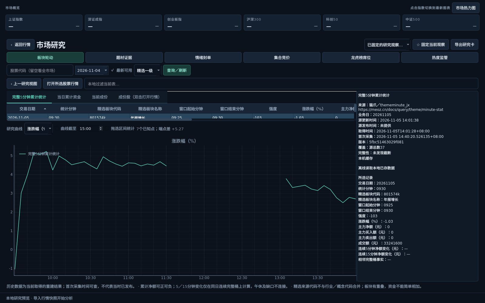

# 市场研究工作区 · 0.13

2026-11-05。六项特色研究已接入同一工作区；使用现有Python／Qt架构，不更换GUI技术栈。龙虎榜已按官方历史服务接入，并完成披露汇总、席位及公开标签的真实联调。具体联调范围见[验证记录](VALIDATION_RESEARCH.md)。



## 使用

1. 设置中选择猫爪并配置自己的API Key，左侧点击“市场研究”。右侧“区间分析”中的折叠题材入口也能打开本股证据页。
2. 选择模块、股票及日期后点击“查询／刷新”。“最新可用”按源的最新业务日查询；选历史日期会取消勾选。留空股票看全市场，竞价及个股封单需要指定股票。
3. 表头点击排序，过滤框只筛选本地表格。双击板块、题材、涨跌停股票或席位进入下一层；“上一研究视图”恢复已有结果，不重新查询。
4. 点击“打开所选股票行情”返回现有分时图；封板事件携带日期和时间，标记最近可用分钟。原先的行情缩放、选区、逐笔功能仍由原工作台负责。
5. “固定当前观察”保存模块、来源、层级、代码及查询条件；顶部列表可重新打开，最多100项。可导出Markdown／JSON研究卡交给其他AI，包含来源、日期、单位、源时间、首次采集、版本、覆盖及缺失说明。

目前为手动查询，不新增自动轮询。API请求复用原始持久缓存、私有密钥及额度账本。鼠标移动、筛选、排序和拖选区间不发请求；切换模块、更改查询条件或切换数据源会取消旧任务。查询时保留已有内容，控件明确提示旧表仍属于上次条件。

## 六个模块

| 模块 | 已实现操作 | 主要口径 |
|---|---|---|
| 板块轮动 | 精选一级／二级排行；双击查看一级完整5分钟统计、当日资金、当前成份；成份涨幅降序，同涨幅净额降序；股票打开行情 | 精选代码保留后缀及层级；涨幅／强度／净额是有单位的统计曲线，不生成假K线 |
| 题材证据 | 当前库、股票反查精选成份、正宗标签、已发布龙排名；题材简介、源内层级和个股关联原文；按选股宝／韭菜公社来源查看解读 | 名称只按精选源内代码补充，不跨来源模糊合并；龙排名先完整展开再按股票过滤，保留并列 |
| 情绪封单 | 涨跌家数、极端涨跌、连板等源指标；涨跌停池、昨日涨停今日表现；双击股票查看历史事件及封单曲线；事件回到分时位置 | 昨日池使用查询日参数；封单减少不是已确认撤单。事件只给已核对的1／2／7／8附中文说明，其余保留源编号 |
| 集合竞价 | 竞价日度指标、当日与前一交易日快照曲线、09:25前最后盘口快照、板块竞价分组 | 比较日使用官方交易日历；匹配／未匹配量转股，最后盘口档量按手标注；未知方向保持空值 |
| 龙虎榜席位 | 单日汇总及买卖榜；按证券筛选；双击席位查询截至所选日近5个交易日；公开关联名单 | 使用历史服务；保留同席位双方向、同股多原因，不合计成持仓 |
| 热度监管 | 最新名单／日度排名、前一交易日排名变化、相对上次本机采集的新进入、四平台共现；风口榜、监管记录、异动候选分别展示 | 最新模式不虚构官方rank；共现源时间可能不同；监管事实与供应商计算候选分表 |

研究曲线可切换指标、拖选查看已知点数量和端点差。勾选“曲线截至”并重新查询，可移除该时刻之后的统计桶／快照。**这是曲线的时间过滤，不是已经验证的“当时已知”回测**：其他日度汇总与榜单仍单独列出；无法证明发布时间时，不作为该时点可得信息。

连续5／15分钟净额变化只有在同日、同板块、连续完整5分钟桶都存在时才计算。午休和缺口不补点、不跨缺口计算；图线断开。涨幅变化按百分点含义理解，不冒充区间收益。事实列“涨幅上升／净额增加”等以零变化为界，可通过本地过滤查看；自定义阈值筛选器留待后续。

## 数据、身份与时间

- `ThemeIdentity`由来源、层级和原始代码组成。精选代码、题材库ID和三方板块代码分开；三方说明表的`symbol`不会被当成股票。股票支持现有沪深A股范围，带交易所后缀的源代码会校验交易所后规范化；北交所尚未并入现有股票图表。
- 保留源`updated_at`、`published_at`（存在才显示）、业务日及窗口字段；取得时间、首次采集和本次观察时间单独保存。没有业务日或源发布时间就显示未提供，不用查询日、抓取时间伪装。
- 仅最新接口在历史模式下读取该日期结束前本机实际采集的版本，缺档不拉今天的数据替代。普通历史接口属于当前取得的历史重建，不能证明当时已发布。
- 本地`research.sqlite`使用追加版本及独立观察记录，支持A→B→A重复出现，同时保留A最初采集时间。最大256MB，达到上限后仍能看新查询，但提示归档失败。现有原始行情缓存和研究档案分别保存。
- 分页最多6页，每页1000行；上限、版本变化和日期不符会明确提示或拒绝。成份展开最多20000行、层级最多12000行，防止无界分配。表格采用虚拟模型，任务在可终止进程执行，单任务超时120秒。
- 1002／无快照、403／权限额度、HTTP 410／迁移或停用说明、离线缺档分别处理；单面板失败不清空其他研究结果，不影响现有行情图。原始密钥不进入任务参数、导出、日志和Git。

## 本次实际边界与后续

已经提供六个可操作研究流程，龙虎榜已切换到官方历史服务；旧日内地址的HTTP 410是迁移提示。最新情绪成功，2026-11-04情绪接口返回1002，该日仍可查看涨跌停池及昨日池。久立当前样本能反查精选成份，但正宗标签及龙排名过滤结果为0，不能描述成数据失败，也不能凭空填补。

本轮没有把精选排行加入旧热力图的类型选择器，入口是新的“市场研究”页；旧行业／概念热力图继续使用原身份及成份流程。题材层级先用带路径的虚拟表格和原文卡呈现。研究备注编辑、预设条件筛选器、龙虎榜完整历史范围与重合统计、事件实时订阅、观察列表自动采集及更复杂关系图继续按P1迭代。

旗舰专有DDX／盘口派生接口、公司事件专题及预测增强均未提前加入依赖。盘后／14:35预测下一交易日仍为P2；本页不输出未经校准的涨跌概率、真实机构身份或自动交易指令。

## 开发与验证入口

```bash
QT_QPA_PLATFORM=offscreen .venv/bin/python -m unittest discover -s tests -p 'test_research*.py'
.venv/bin/python -X faulthandler -m scripts.check_research_desktop --day 20261104
```

第二个脚本强制offscreen，默认只读取缓存并生成本地截图，不调用真实API，也不显示到工作桌面；需要已有相应日期缓存。接口来源和更细的测试记录见[验证记录](VALIDATION_RESEARCH.md)，原需求见[规划](MEOZ_SPECIALTY_FEATURE_PLAN.md)。
