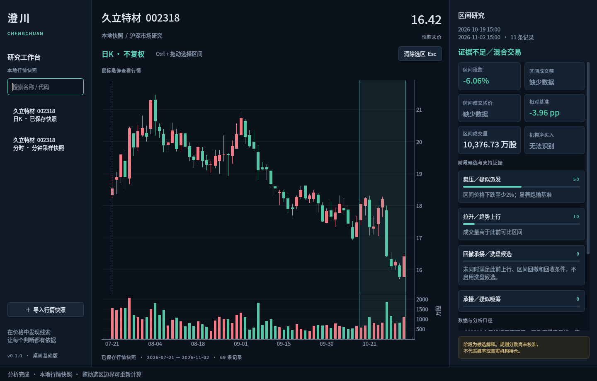

# 澄川：界面与交互规范

默认风格：克制的深色专业工作台。用留白、对齐、层次和数据密度形成现代感，主图占据主要空间，分析结果辅助阅读。

## 当前真实界面

截图来自实际PySide6窗口和久立历史快照，不是界面效果图或实时行情。当前阶段支持本地快照，功能范围见PRODUCT。

另见[分时工作台真实截图](../design/chengchuan-intraday.png)。

## 布局

参考1440×920窗口：左侧快照／后续自选约220像素，中间图表自适应，右侧研究面板约355像素。支持拖动分隔栏，保存宽度。最小窗口1100×740；不同分辨率和高DPI需要实机验收。

- 左侧品牌、搜索、列表，导入操作固定在底部。
- 主图上方为股票、快照末价、周期、选区提示和悬停行情。
- 主图与成交量共用交易记录时间轴，纵轴按各自口径显示。
- 右侧首先显示选区，再显示结果；证据与数据口径可以向下滚动。
- 底部状态栏用于加载、成功和失败提示，长期错误不能只靠一闪而过的提示。

## 视觉变量

| 语义 | 颜色 |
|---|---|
| 主背景 | `#0c121b` |
| 侧栏与分析区域 | `#101a27` |
| 内容块 | `#142233` |
| 主文字 | `#dce6f0` |
| 次级文字 | `#8193a8` |
| 强调与当前操作 | `#5ad7bf` |
| 上涨 | `#f07b86` |
| 下跌 | `#52c7a3` |
| 选区 | 青色半透明填充、可辨识边界 |

默认使用A股红涨绿跌。涨跌同时保留正负号，不能单凭颜色表达。主题、涨跌配色、字号和色觉适配后续设置化，图表和结果面板共享语义色变量。

中文字体依次尝试Noto Sans CJK SC、Microsoft YaHei UI、PingFang SC及系统字体。信息正文约13像素，股票标题24像素，末价29像素；避免大量超大数字挤占K线空间。

## 键鼠契约

| 操作 | 行为 |
|---|---|
| Ctrl＋左键拖动 | 选择时间范围，左右拖动结果一致 |
| 普通拖动／滚轮 | 平移／缩放图表 |
| 选区边界拖动 | 调整完整K线范围，结束后重算 |
| Esc | 清除当前选区并丢弃迟到分析结果 |
| Ctrl＋O | 导入本地行情快照 |
| 悬停 | 十字光标、时间与实际行情字段 |

Ctrl选区以完整记录为单位。选区与可见范围相互独立；跨午休或周末不增加虚构K线。单条行情只显示选择提示，阶段引擎至少需要两条。

## 状态设计

必须区分：未选择、加载中、计算中、有结果、缺少数据、操作失败。零值正常显示，缺失显示原因，规则分数标为未校准。用户界面只显示与研究判断有关的口径，详细异常堆栈进入本地日志。

当前任务失败能恢复继续操作。长时间加载的取消入口、网络状态与缓存过期状态在M1补齐。

## 后续设计重点

股票目录与自选、多周期工具条、MA等指标、选区对比、注释和事件标记按ROADMAP分步加入。每项新增操作必须有选中、悬停、禁用、加载和失败状态设计，避免只绘制静态按钮。
