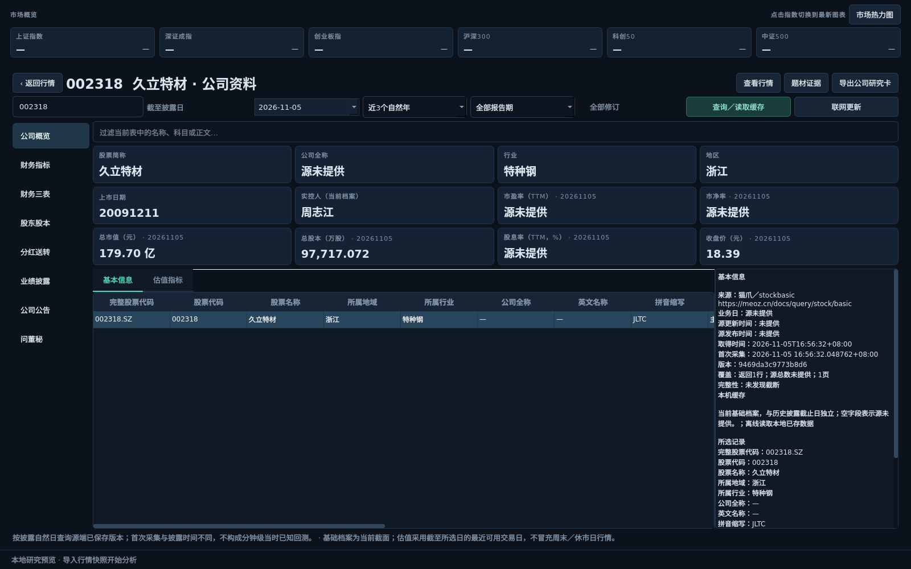
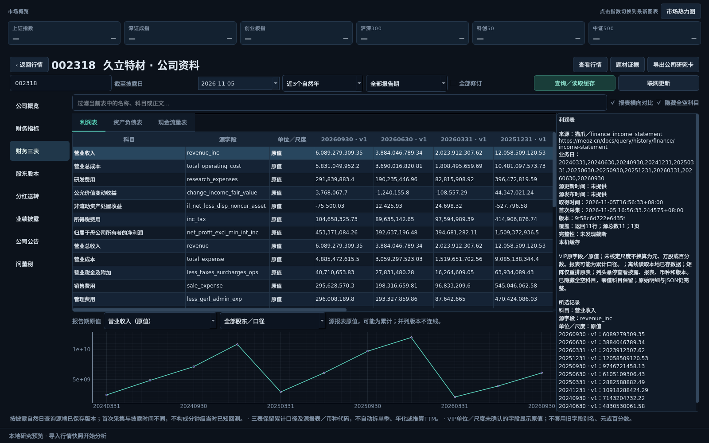
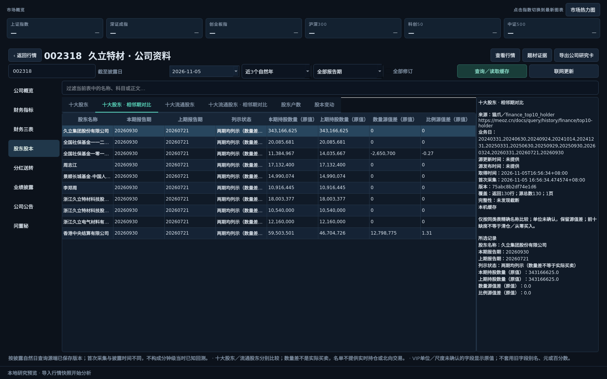

# 公司资料交付与验证记录 · 0.14.0

日期：2026-11-05。环境：Ubuntu 22.04.5、Python 3.10.12、PySide6 6.11.3、pyqtgraph 0.14.0。规划见[功能规划](COMPANY_INFORMATION_PLAN.md)，入口与操作见[使用说明](COMPANY_INFORMATION.md)。

## 交付范围

独立公司资料工作区包含概览、财务指标、三表、股东股本、分红送转、业绩披露、公告、问董秘八类。支持单只沪深股票、日级披露截止日、近1／3／5个自然年、指定报告期、最新／全部修订、本地筛选排序、财报矩阵、原值曲线、股东相邻期对比及Markdown／JSON导出。

增加16个用途适配，逐个读取猫爪官方目录1.0.52的契约，保留操作ID和文档链接。基础及估值用已确认的日内服务，财务／公告／问答用`history90_reference_*`历史操作，不尝试已撤下的旧财务日内操作，不按日期猜服务。原始字段适配共470项，实际响应的新增字段也保留。

公司档案使用独立`company.sqlite`；HTTP、私有缓存、额度、追加归档、进程任务和表格复用已有实现。通用证据导出与说明面板抽取共用，旧档案缺少字段description仍可读取，空description保留原内容哈希。

## 真实接口联调

条件：股票002318，披露截止日2026-11-05，近3个自然年、最新版本。下表是接口实际返回条数，不代表市场整体覆盖完整；并列版本可能同时返回。

| 分类／接口 | 返回行数 | 实际字段数 | 说明 |
|---|---:|---:|---|
| 基础资料 | 1 | 17 | 公司全称等部分字段为null，保持缺失 |
| 估值 | 28 | 21 | 45个自然日查询窗内的可用交易日，实际日期单列 |
| 财务指标 | 11 | 33 | 有并列版本标志，不选取唯一值生成确定曲线 |
| 利润表 | 11 | 59 | 原字段／原值，保留累计口径 |
| 资产负债表 | 11 | 120 | 零和null独立保存 |
| 现金流量表 | 11 | 98 | 不自动拆季或年化 |
| 十大股东 | 130 | 15 | 另生成10行相邻期比较 |
| 十大流通股东 | 120 | 15 | 另生成11行相邻期比较，名单缺席不补零 |
| 股东户数 | 12 | 13 | 有并列版本标志 |
| 股本事件 | 18 | 11 | 不推断为股东实际买卖 |
| 分红送转 | 8 | 11 | 每股现金等明确单位按契约显示，阶段分别列示 |
| 预约披露日期 | 6 | 8 | 预约／变更／实际日期分别保留 |
| 业绩预告 | 2 | 15 | 已披露的未来报告期预告可以显示 |
| 业绩快报 | 0 | 19 | 有效空结果，不冒充权限失败或补零 |
| 公司公告 | 239 | 6 | 本地筛选、点击原文；不自动下载附件 |
| 问董秘 | 2 | 9 | 保留问题与回答时间，按回答日筛选 |

另用600519验证概览和指标：基础1行、估值28行、指标11行，确认证券身份隔离。没有查询其他股票的全部分类，因此不宣称所有股票、全部历史期间都已联调。

上述查询均未触及单接口6页／3000行、512字段保护上限；源响应分页完成标志与归档正常。`complete`只表示本次查询未发现分页截断，不代表源端历史回填已经完整。

## 自动化与后台验收

| 检查 | 结果 |
|---|---|
| 完整源码回归 | 294项通过，45.554秒 |
| 本功能专项 | 32项，含22项核心、10项Qt界面测试 |
| Ruff | `chengchuan tests scripts`检查通过；核心、UI、脚本及新增测试格式检查通过 |
| 真实缓存界面 | 八类页面全部通过生产进程任务读取；仅offscreen，无前台窗口 |
| 小窗口 | 请求1100×740，实际1100×740；表格／图线可拖动分配高度 |
| wheel | 成功构建`chengchuan-0.14.0-py3-none-any.whl` |
| 无Qt安装包回归 | 从`/tmp`运行已安装包，294项发现、81项GUI跳过、其余213项通过，14.699秒 |
| 无凭据／无HTTP回放 | 已安装包八分类及全部Markdown／JSON导出通过；读取密钥及HTTP调用均设为抛错，未触发 |

专项覆盖：源字段动态增量、零／负数／null、端点间同名字段语义隔离、单位不猜测、未来披露拦截、已披露未来报告期预告保留、QA不传未支持的`as_of`、问答日期、季度参数互斥、并列修订、币种与报表代码分组、同名／缺席股东、持股性质变化、分页位置／上限、离线空记录回放、旧档案兼容、矩阵／本地筛选不联网、查询取消与旧结果拦截、切源与切股、显式外链协议、当前价格图不受资料查询影响。

外链测试注入替代打开器；即使offscreen，也不启动外部浏览器。截图脚本同样强制offscreen并禁用外链，未在用户桌面显示应用。复验命令见[使用说明](COMPANY_INFORMATION.md#缓存稳定性与复验)。

## 尚未覆盖与数据限制

- 财务指标、三表及多数股东股本字段在1.0.52契约中尚未核定单位／尺度，以“原值”呈现。`finance_indicator.net_profit`为净利率，不是利润金额；不会拿旧Tushare字段别名填造数据。
- 资料页是日级披露回看，非严格分钟级当时已知数据库。源可能回填；部分公告没有独立披露时间；并列版本、缺失披露日及源更新时间均保留提示。
- 财务契约首期标注2026起回填，但实际含更早记录；公告仅保留2025—2026部分，问答自2026-06-26积累。资料年限不承诺源覆盖。基础档案是当前截面，不作为历史实控人档案。
- 没有凭空补足完整F10主营构成、客户供应商名单、联系方式、实时机构账户或北向持仓。股东数量源值差不是资金净买额。
- 尚未做Windows原生桌面、全部套餐权限、所有股票或长时间压力运行验收。本期不增加投资评分与预测模型，预测增强继续P2。

原始响应、缓存数据库、测试日志及本地导出保存在忽略目录／私有缓存中，不纳入版本库。公开交付仅包含代码、契约字段说明、测试、文档与少量界面截图。
